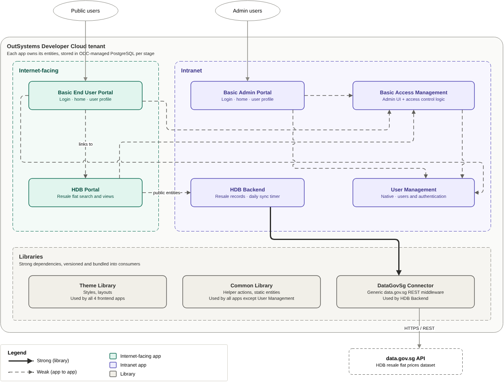
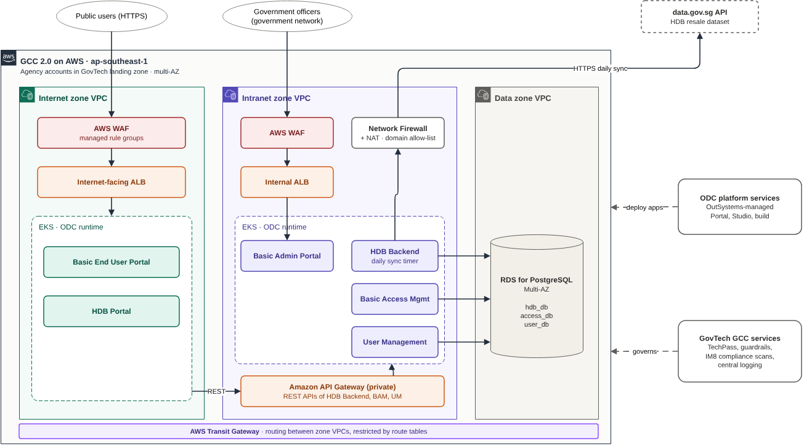
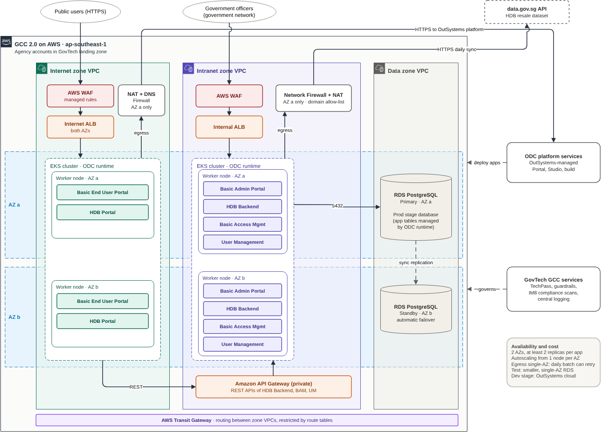

# HDB Resale Flat Prices on OutSystems Developer Cloud

## 1. What the app does and who it is for

### What it does
- Syncs the **HDB resale flat prices** dataset from the data.gov.sg API once a day and stores it locally.
- Lets users search and view resale flat records through a web portal.
- Provides login, home and user profile functions for both public and intranet users.
- Lets administrators manage users and access control (roles and permissions).

### Who it is for

| Audience | Access | Applications used |
|---|---|---|
| Members of the public | Internet | Basic End User Portal, HDB Portal |
| Government officers and administrators | Intranet (government network) | Basic Admin Portal, Basic Access Management |

### Data source
- Dataset: HDB resale flat prices, `d_8b84c4ee58e3cfc0ece0d773c8ca6abc` on data.gov.sg
- Refresh: a daily batch job (timer) in HDB Backend

---

## 2. Architecture diagram

### 2.1 Application architecture


Source: `docs/diagrams/hdb-resale-odc-architecture.drawio`

| # | Component | Type | Zone | Responsibility | Depends on |
|---|---|---|---|---|---|
| 1 | Common Library | Library | n/a | Helper actions and static entities shared by all apps except User Management | n/a |
| 2 | Theme Library | Library | n/a | Styling and layouts for all frontend apps | n/a |
| 3 | DataGovSg Connector | Library | n/a | Generic middleware for calling any data.gov.sg API | n/a |
| 4 | User Management | App (backend) | Intranet | User records and authentication | n/a |
| 5 | Basic Access Management | App (frontend + backend) | Intranet | Admin UI for access control, plus all access control logic | User Management, Common, Theme |
| 6 | Basic Admin Portal | App (frontend) | Intranet | Login, home and user profile for intranet frontend apps | User Management, Basic Access Management, Common, Theme |
| 7 | HDB Backend | App (backend) | Intranet | Calls the HDB resale API through the connector; daily sync timer | DataGovSg Connector, Common |
| 8 | HDB Portal | App (frontend) | Internet | Displays resale data from HDB Backend | HDB Backend (REST), Basic Access Management, Common, Theme |
| 9 | Basic End User Portal | App (frontend) | Internet | Login, home and user profile for internet frontend apps | User Management, Basic Access Management, HDB Portal, Common, Theme |

Libraries are strong dependencies, versioned and bundled into each consumer at publish time. App-to-app references are weak dependencies. Calls from the internet zone to the intranet zone go over REST through the private API Gateway.

Databases (PostgreSQL): HDB Backend (`hdb_db`), Basic Access Management (`access_db`), User Management (`user_db`).

### 2.2 Deployment architecture, GCC option (logical)


Source: `docs/diagrams/hdb-resale-odc-gcc2.drawio`

### 2.3 Deployment architecture, GCC option (physical, multi-AZ)


Source: `docs/diagrams/hdb-resale-odc-gcc2-ha.drawio`

Summary:
- **Hosting:** Government on Commercial Cloud (GCC) 2.0 on AWS, `ap-southeast-1`, two availability zones.
- **Zones:** three VPCs, for internet, intranet and data.
- **Compute:** the ODC self-hosted runtime on Amazon EKS, one private cluster per user-facing zone.
- **Entry points:** AWS WAF → ALB for each zone. A private Amazon API Gateway is the only path from the internet zone to the intranet zone.
- **Data:** Amazon RDS for PostgreSQL Multi-AZ in the data zone, reached from the intranet zone through Transit Gateway.
- **Egress (single-AZ):** in the intranet zone, AWS Network Firewall (domain allow-list) plus NAT Gateway, for the data.gov.sg sync and the OutSystems platform. In the internet zone, NAT Gateway plus Route 53 DNS Firewall, for the OutSystems platform only.

---

## 3. Key decisions and trade-offs

### 3.1 Hosting: OutSystems cloud (ODC SaaS) vs GCC 2.0 (ODC self-hosted)

| Aspect | OutSystems cloud (ODC SaaS) | GCC 2.0 (ODC self-hosted runtime on EKS) |
|---|---|---|
| **Hosting model** | Fully managed by OutSystems: runtime, database and platform in OutSystems' AWS tenant | Portal, platform services and the Dev stage stay in OutSystems' cloud. Test and Prod runtimes and data run in the agency's GCC accounts. |
| **Government hosting policy** | Outside the GCC wrapper; likely needs a policy exception | Inside GCC, with GovTech guardrails and continuous IM8 compliance scanning |
| **Data and key control** | ODC-managed database and keys | Agency-owned RDS PostgreSQL in `ap-southeast-1` and a customer-managed KMS key |
| **Internet / intranet segregation** | Logical only (identity and roles); all apps on public ODC endpoints | Network-level: separate VPCs with a single controlled entry point |
| **Edge security and audit** | ODC's built-in protections; no customer WAF or firewall; limited infrastructure logs | Agency-controlled AWS WAF, Network Firewall, DNS Firewall and full infrastructure logging |
| **Availability and scaling** | Built in and managed by OutSystems | Designed and run by the team |
| **Operational effort** | Minimal | Significant: Kubernetes, PostgreSQL, network and certificates are the agency's responsibility |
| **Cost and time to go live** | ODC subscription only; fast | Subscription plus self-hosted add-on, AWS infrastructure and operations effort; slower (GCC onboarding, infrastructure build) |
| **Maturity** | The standard ODC model | Released 31 March 2026; support for this GCC setup still to be confirmed |

**Recommendation: OutSystems cloud (ODC SaaS).**

Why:
- ODC self-hosted was only released in March 2026. It is relatively new and less proven in production, and key points for this design (EKS in GCC, one stage across two clusters, the database layout, GCC approval for the outbound connection) are still unconfirmed.
- The core dataset is open data (HDB resale prices), so hosting in OutSystems' cloud carries little data risk.
- Lowest cost and operational effort, and the fastest time to go live. Availability, scaling and platform upgrades are handled by OutSystems.

**When to choose GCC 2.0 (ODC self-hosted) instead:** when the system must be hosted inside GCC, when internet and intranet users must be segregated at network level, or when the agency must control the data, encryption keys, edge security and audit logs. The infrastructure design, diagrams and Terraform in this repository cover that option, so the system can move to GCC once ODC self-hosted is proven and confirmed for this setup.

### 3.2 Key design decisions for the GCC option

| # | Decision | Why | Trade-off |
|---|---|---|---|
| 1 | **Separate VPCs for the internet, intranet and data zones.** The internet zone isn't attached to Transit Gateway; its only path into the intranet is a private API Gateway (PrivateLink). | Real network segregation, with one controlled, logged and inspectable entry point | More networking components and cost (endpoints per VPC, Transit Gateway) |
| 2 | **REST through the API Gateway** for internet-zone apps calling intranet apps, instead of ODC weak references (public entities, service actions) | Weak references can't cross the zone boundary | Extra API design and maintenance; no cross-app joins |
| 3 | **AWS WAF on both zones**, not just the internet zone | Defence in depth: intranet users and devices aren't trusted by default | Cost of a second web ACL |
| 4 | **Active-active EKS across 2 AZs** (at least 1 node and 2 replicas per app in each AZ) with **RDS Multi-AZ** (active-passive) | Survives an AZ failure without an outage; two half-size nodes cost about the same as one large node | Pays for an idle database standby; apps must be stateless |
| 5 | **Single-AZ egress** (Network Firewall + NAT in AZ a only) | Only the daily sync uses it, and it can retry | The sync fails while AZ a is down, until re-run |
| 6 | **Daily batch sync** from data.gov.sg instead of live API calls | Fast reads from local data; no runtime dependency on data.gov.sg | Data can be up to a day old |
| 7 | **The region is the failure boundary** (no cross-region DR) | Keeps cost and complexity proportionate | A full region outage means downtime |

---

## 4. Assumptions

### OutSystems cloud (recommended option)
- The agency is allowed to host this system on OutSystems cloud; the HDB resale data is open data.
- An OIDC identity provider (Singpass for public users, the government identity provider for officers) is configured in ODC Portal.

### ODC self-hosted (GCC option)
- **Released product:** ODC self-hosted is generally available (announced 31 March 2026). It runs on any CNCF-conformant Kubernetes distribution, so it is assumed to support Amazon EKS. Supported Kubernetes and PostgreSQL versions are to be confirmed against OutSystems' system requirements.
- **Stages:** only the Test and Prod runtime stages run in GCC. The ODC Portal, platform services (build, deploy) and the Dev stage stay in OutSystems' cloud. Dev uses non-sensitive or dummy data only.
- **GCC approval:** GovTech allows the self-hosted clusters to keep a permanent outbound connection to OutSystems' cloud (connections always start from the cluster), and the required OutSystems domains can be allow-listed for egress.
- **Licensing:** the self-hosted add-on is included in the agency's OutSystems subscription.
- **Two clusters per stage:** one Prod stage can span two clusters (internet zone and intranet zone). If not, segregation would move to separate ingress within one cluster, or to two stages.
- **Database:** each runtime stage connects to its own dedicated PostgreSQL database (RDS), whose app tables are managed by the ODC runtime. The per-app database split (`hdb_db`, `access_db`, `user_db`) may not apply and is to be confirmed.
- **Identity:** an external OIDC identity provider is required. Public users are assumed to sign in with Singpass, and officers with the government identity provider.
- **Ingress:** the AWS ALBs route traffic to ODC's in-cluster ingress controller.
- **Operations:** the agency is responsible for patching and upgrading Kubernetes and PostgreSQL, with staff experienced in running production Kubernetes.

### GCC and infrastructure
- The data classification of the HDB data and the user data is allowed on GCC 2.0. Confidential data would need GCC+ / Dedicated Local Zones.
- The GCC landing zone allows the agency to create VPCs, an internet gateway, NAT, Transit Gateway and Network Firewall. If GCC provides central egress, it is used instead.
- GCC provides routing from the government network to the intranet zone.
- Central security services (GuardDuty, Security Hub, CloudTrail, AWS Config) are enabled by the GCC landing zone.
- ACM certificates for the public and intranet hostnames are provided.

### Application
- The HDB Backend daily sync is idempotent and can be safely re-run.

---

## 5. Security, compliance and performance considerations

On OutSystems cloud (recommended option), infrastructure security, availability and scaling are provided and managed by OutSystems. The controls below describe the GCC option.

### Security
- **Perimeter:** AWS WAF with AWS managed rule groups on both ALBs and the API stage. The internet zone also has IP reputation filtering and per-IP rate limiting.
- **Zone isolation:** separate VPCs. The internet zone reaches the intranet only through the private API Gateway, whose resource policy accepts only the internet VPC's endpoint.
- **Egress control:** Network Firewall domain allow-list in the intranet zone; DNS Firewall allow-list in the internet zone.
- **Private by default:** EKS API endpoint, nodes and RDS are private, and AWS services are reached through VPC endpoints.
- **Encryption:** customer-managed KMS key at rest (EKS secrets, EBS, RDS, logs); TLS 1.2+ in transit, with TLS enforced on RDS.
- **Secrets:** the RDS master password is generated and rotated in Secrets Manager.
- **Logging and audit:** VPC flow logs, plus WAF, Network Firewall, EKS, API Gateway and ALB logs.

### Compliance
- Hosted on GCC 2.0, with continuous compliance scanning against IM8 by the GCC platform.
- Data stays in `ap-southeast-1` (Singapore).
- Log retention defaults to 365 days (`log_retention_days`).

### Performance and availability
- **Read performance:** data is served from HDB Backend's local copy, not from data.gov.sg at request time.
- **Scalability:** EKS node groups scale from a baseline of 2 nodes (1 per AZ) up to a configurable maximum (requires Karpenter or Cluster Autoscaler). RDS storage autoscales.
- **API protection:** API Gateway throttling (`api_throttle_rate`, `api_throttle_burst`).
- **Availability:**
  - AZ failure on EKS: traffic moves to the surviving AZ within seconds (active-active).
  - AZ failure on RDS: automatic failover to the standby, typically within a minute or two.
  - Egress: single-AZ by design.

---

## 6. How to deploy and how to run the tests

Two deployment options are supported. **OutSystems cloud is the recommended choice** unless the system must be hosted inside GCC with network-level segregation (see section 3).

### 6.1 Option A: OutSystems cloud (ODC SaaS), recommended

No infrastructure to provision. OutSystems hosts the runtime, the database and the Dev, Test and Prod stages.

Prerequisites:
- An ODC tenant (organization) with Dev, Test and Prod stages
- An OIDC identity provider for end users (for example Singpass for public users, and the government identity provider for officers)

Steps:
1. In ODC Portal, configure the identity provider(s) for the apps.
2. In ODC Studio, publish the libraries first: Common Library, Theme Library, DataGovSg Connector.
3. Publish the apps in dependency order: Basic Access Management, Basic Admin Portal, HDB Backend, HDB Portal, Basic End User Portal. User management is handled natively by the ODC platform.
4. Set each app's settings in ODC Portal for the stage, such as the data.gov.sg API endpoint and dataset ID.
5. The `InitializeData` and `BootstrapAccessControl` timers in Basic Access Management seed the initial data and access control. HDB Backend's daily sync timer loads the resale data.
6. Promote the apps from Dev to Test to Prod with ODC Portal's deployment.

### 6.2 Option B: GCC 2.0 (ODC self-hosted runtime on EKS)

Use this option when the system must be hosted inside GCC. Only the Test and Prod stages run in GCC; Dev stays in OutSystems' cloud.

#### Infrastructure (Terraform)

Prerequisites:
- GCC 2.0 AWS account(s) and a deployment role
- Terraform ≥ 1.6 or OpenTofu ≥ 1.6 (AWS provider 6.x)
- ACM certificates for the public and intranet hostnames
- The OutSystems platform domain list for `odc_platform_domains`
- A federated admin role for `eks_admin_role_arns`

```bash
cd infra
cp backend.tf.example backend.tf                 # set the state bucket
cp terraform.tfvars.example terraform.tfvars     # fill in ARNs, CIDRs, domains

terraform init
terraform plan -out tfplan
terraform apply tfplan
```

#### Post-deployment
1. Install the AWS Load Balancer Controller in both clusters, and bind the ODC ingress service to the target groups with `TargetGroupBinding`.
2. Install Karpenter or Cluster Autoscaler in both clusters.
3. Install the ODC self-hosted runtime in both clusters.
4. Publish the apps and libraries from ODC Studio. The `InitializeData` and `BootstrapAccessControl` timers in Basic Access Management seed the initial data and access control.
5. Point DNS at the ALBs: the public hostname at `internet_alb_dns_name`, the intranet hostname at `intranet_alb_dns_name`.

### 6.3 Tests

Infrastructure, Option B only (offline, mocked AWS provider, no credentials needed):

```bash
cd infra
terraform init -backend=false
terraform validate
terraform test          # or: tofu test
```

---

## 7. What is manual and what is automated

| Area | Automated | Manual |
|---|---|---|
| AWS infrastructure (network, edge, EKS, RDS) | Terraform | n/a |
| Initial data and access control | `InitializeData` and `BootstrapAccessControl` timers in Basic Access Management | n/a |
| Kubernetes add-ons and ODC runtime installation | n/a | Helm and the OutSystems installer, per cluster |
| App build and deployment | ODC publish and deployment between stages | Triggered from ODC Portal or Studio |
| Daily data sync | HDB Backend timer | Re-run after a failure, if needed |
| ACM certificates and DNS records | n/a | Requested or set up by the domain owner |

---

## 8. Known gaps and what I would do next

### Known gaps
- **HDB Portal calls HDB Backend through service actions.** This works on OutSystems cloud, but the GCC option's API Gateway needs a REST API. Service actions already use OutSystems' own REST-based protocol, so converting them to exposed REST APIs is straightforward.
- **No application unit tests.** No automated tests with a BDD framework yet.
- **No caching.** Read-heavy actions, aggregates and Advanced SQL queries aren't cached yet.
- **Kubernetes components aren't codified (GCC option).** The AWS Load Balancer Controller, autoscaler and ODC runtime are installed by hand.
- **Terraform not tested against AWS (GCC option).** The Terraform has passed `validate` and a mocked plan, but hasn't been applied to a real account.
- **ODC self-hosted setup is unconfirmed (GCC option).** EKS support, one stage across two clusters, the database layout, and GCC approval for the outbound connection all need confirming with OutSystems and GovTech.
- **Identity design isn't finalised.** The role of User Management alongside Singpass and the government identity provider is still open.
- **No cross-region disaster recovery.**

### What I would do next
1. Before moving to the GCC option, confirm the ODC self-hosted requirements with OutSystems (EKS and version support, one stage across two clusters, database layout), and GCC egress and landing-zone constraints with GovTech.
2. For the GCC option, expose HDB Backend's service actions as REST APIs and route HDB Portal's calls through the private API Gateway.
3. Add unit tests with a BDD framework for core logic (sync, access control, search), and run them before each deployment to Test.
4. Add caching to suitable actions, aggregates and Advanced SQL queries, refreshed after each daily sync.
5. For the GCC option, build a CI/CD pipeline for the Terraform (plan on pull request, apply on approval) using GCC-approved tooling.
6. Define performance targets and RTO/RPO, then load-test.
7. Evaluate cross-region DR (pilot light) if the RTO requires it.
